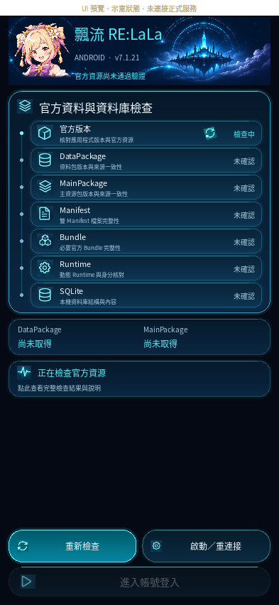
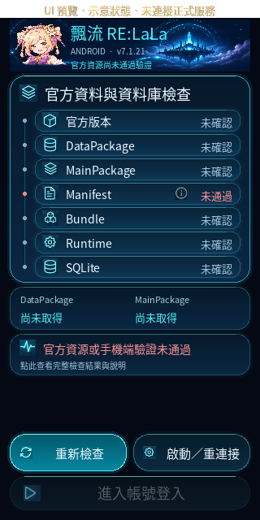
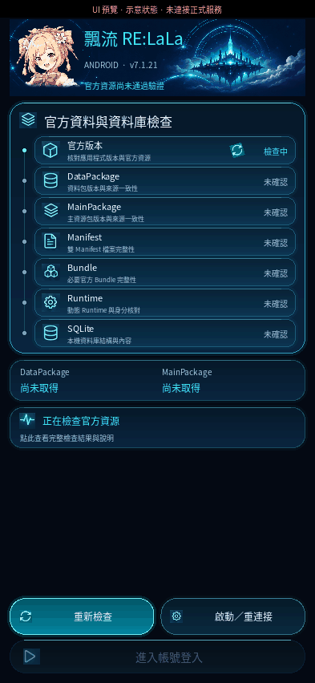

# Resource verification UI preview

Scope: only the Android resource-verification entry screen. No login-gate,
service, resource-validation, account, gameplay, version, or release logic is
changed. This is a UI-first candidate, not an Android-device acceptance result.

## Visual source

- `android_app/assets/verification_reference.png` is the user's supplied
  941×1672 design image, retained unchanged as a texture atlas. The UI samples
  only decorative icon regions. It does not display the full screenshot or
  sample its example package versions, timestamps, successful rows or buttons.
- `verification_header_art.png` is an image-generation derivative of that
  supplied design, with text, status badges and UI icons removed. It is not an
  official game asset or a pixel-identical extraction. The girl and floating
  castle are decorative; current version and resource status are live labels.
- Raster assets do not determine success. `verification_presentation.view_state`
  and the existing double-ended catalog gate remain authoritative.
- All pictograms, including the bottom actions, now use sampled raster images.
  The user requested retry and start/reconnect on the same row, with login below.
  The three original callbacks and the explicit manual-login action are retained.
- The entry screen itself has no ScrollView. Seven checks, observed package
  versions, current status and actions fit on the first screen. Small screens
  use single-line checks; tap the status card for complete descriptions,
  diagnostics and timestamps in a separate scrollable dialog.
- Only a check whose true state is `checking` continuously rotates its bitmap 360 degrees. All
  other states and action icons remain static. Animations stop on pause, stop,
  state changes, direct removal or ancestor/root removal from the Window.

## Run the actual widget without servers

```sh
python -m pip install -r requirements-dev.txt
python tools/android_verification_preview.py --width 393 --height 852 \
  --state checking --output verification-checking.png
```

The tool constructs `VerificationDashboard` directly. Launching desktop
`main.py` instead would open the desktop-mode login view, not this Android gate.

`--state` accepts `pending`, `checking`, `passed`, or `blocked`. These are
explicitly labelled UI fixtures. No game server, account, IPC connection or
Android service is started. In preview, retry and service actions change only
local preview state; enter only updates the preview notice. All fixtures live
under `tools/`, which APK staging excludes. The actual application still injects
its real existing callbacks.

For a Linux cloud machine without a display:

```sh
SDL_VIDEODRIVER=offscreen KIVY_NO_ARGS=1 LIBGL_ALWAYS_SOFTWARE=1 \
  python tools/android_verification_preview.py --width 320 --height 640 \
  --font-scale 1.3 --state blocked --output verification-small.png
```

The screenshot is exported after three seconds of Kivy layout/rendering.
Preview uses the bundled Chinese font, or a clearly local system Noto CJK
fallback if the checkout has not materialized the bundled font. No fallback font
is committed. Desktop rendering does not prove Android IME, density, GPU,
background/resume or device performance.

## Validation in this revision

- Real Kivy 2.3.1 / SDL2 offscreen / Mesa llvmpipe rendering in the cloud.
- 320×640, 360×780, 393×852, 430×932 layout contracts and 130% font-scale checks.
- Dedicated regressions for visible separate bottom actions, row/version
  wrapping, image-independent approval, callback routing and texture reload
  observers.
- Initial/pending, checking, passed, blocked, disconnection and mismatched-token
  cases retain the existing fail-closed semantics.
- Focused verification tests: 25 passed. Full Python suite: 1323 tests, passed with 8 platform/environment skips.
- Cloud screenshots used the available system Noto Sans CJK font as a local fallback; no font change is part of this patch.
- No APK, Android-device or official-server validation is claimed.

## Cloud-rendered previews

These are actual Kivy widget captures with explicitly labelled offline fixtures,
not composited design mockups and not Android-device screenshots.







Record the actual widget animation using `--animation-output checking.gif`.
The preview records 18 Kivy-rendered frames, without contacting a server.
